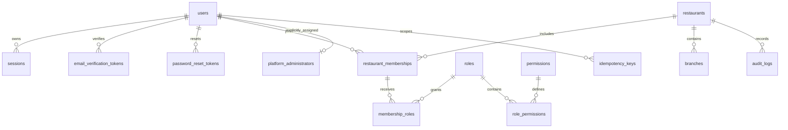

# Phase 1 architecture

The repository is an npm workspace with `apps/web`, `apps/api`, and `packages/contracts`. TypeScript is used throughout the application. Browser-safe Zod schemas and enums are shared; the server is authoritative for validation and permission decisions. Next.js route components compose feature components. API controllers handle HTTP, services orchestrate work, and repositories execute parameterized SQL. `app.ts` exports Express without listening. `server.ts` checks configuration and PostgreSQL before listening and drains HTTP/pool resources on SIGINT/SIGTERM.

Request flow: request ID → security headers → exact CORS allowlist → cookies/body limit → sanitized HTTP logging → signed CSRF validation → route rate limiting → schema validation → authentication → active tenant membership/status → explicit permission → tenant-scoped repository → consistent errors. Identity/tenant responses carry `Cache-Control: no-store`. Logs contain path without query strings, request ID, method, status and duration; request bodies/cookies/tokens are not logged.

## Relationships

All entity IDs are random UUIDs; timestamps use TIMESTAMPTZ. Emails are trimmed/lowercased at validation/storage and have a unique lower(email) index. Slugs are lower-case alphanumeric segments joined by single hyphens, unique globally, and immutable through Phase 1 settings. Restaurant currency and IANA timezone are explicit. A user/restaurant pair has at most one membership. Branch slugs are tenant-unique and a partial index permits at most one default branch.

System roles are global templates; a custom role may only be assigned to a membership from the same restaurant. A database trigger rejects cross-tenant assignment. Role and membership tenant ownership are immutable, preventing later moves from invalidating isolation. Tenant-scoped read/update/branch repository methods require a `TenantContext`. Controllers pass only the context resolved from the URL and live membership query. Related-record creation receives restaurant IDs from the newly created parent inside the transaction. Public schemas reject extra owner/role/tenant/admin fields.

`platform_administrators` is an explicit assignment table. The inherited `users.is_platform_admin` field is retained for database compatibility, but authentication authorization reads the assignment table. Restaurant roles grant no platform authority. There are no platform administration HTTP operations in Phase 1; future operations must require explicit platform authorization and audit events.

## Sessions and identity

Passwords use bcrypt cost 12, with a 72 UTF-8 byte limit to prevent silent truncation. Opaque 256-bit random session tokens appear only in HttpOnly, host-only cookies; PostgreSQL stores SHA-256 hashes. Sessions expire absolutely, are checked on every request, and are revoked on logout/password reset. Repeat login rotates the presented session. Tokens are never stored in localStorage.

CSRF uses a random nonce plus an HMAC bound to the session token and COOKIE_SECRET. Cookie/header equality, HMAC verification, and allowed Origin/Fetch Metadata checks protect mutations. A forged Bearer header cannot bypass validation; bearer authentication is not supported. Login/registration also reject hostile Origins. The readable CSRF cookie contains no session credential. `/auth/me` supplies a refreshed CSRF cookie after reload.

Verification/reset tokens are 256-bit random values with hashed storage, 24-hour / 1-hour expirations, and atomic conditional UPDATE consumption. Verification and password updates happen in the same transaction as consumption. Password reset revokes all sessions. Forgot/resend responses are generic. Login errors are generic. Registration reports duplicate addresses to support account recovery.

SMTP uses Nodemailer and never silently falls back to memory. Local-only memory capture is explicitly available for testing. Email delivery failures are logged without message content; committed accounts can request another verification message. There is no durable email outbox in Phase 1, so SMTP availability and resend behavior must be monitored.

## Permissions

| Action                                          | Owner | Manager | Staff |
| ----------------------------------------------- | ----- | ------- | ----- |
| View restaurant/branches                        | Yes   | Yes     | Yes   |
| Access workspace                                | Yes   | Yes     | Yes   |
| Update restaurant                               | Yes   | Yes     | No    |
| Restaurant archive permission (future endpoint) | Yes   | No      | No    |
| Platform administration                         | No    | No      | No    |

There is no role-name bypass: authorization checks explicit permissions. Permission queries are rebuilt from the active membership for every protected operation. Revoked membership and suspended/archived restaurants are denied. Inaccessible restaurants receive a safe forbidden response. UI hiding improves navigation only.

## Atomic onboarding and retries

A verified session user is the owner; the body never supplies ownership. A single checked-out PostgreSQL connection creates restaurant, initial branch, owner membership, role assignment, audit event, and retry record. Failure rolls everything back and always releases the connection. The frontend keeps one UUID idempotency key while retrying an unchanged payload and creates a new key after edits. A user/key advisory transaction lock serializes simultaneous retries. Normalized validated payload hashes detect mismatch; records expire after 24 hours. An expired key can be reused, but the global slug constraint still prevents duplicates. Missing keys retain predictable slug-conflict behavior.

Private state is component-local and keyed by restaurant ID. Switching unmounts the workspace, clears data, and ignores stale fetch completions. Logout clears the session and performs a fresh navigation. No sales/orders/analytics are invented; onboarding stays private and later functionality is clearly described as unavailable.

Framework configuration was checked against the official [Next.js 16 upgrade guide](https://nextjs.org/docs/app/guides/upgrading/version-16), [rewrites reference](https://nextjs.org/docs/app/api-reference/config/next-config-js/rewrites), [Zod migration guide](https://zod.dev/v4/changelog), and [node-pg-migrate documentation](https://salsita.github.io/node-pg-migrate/).
