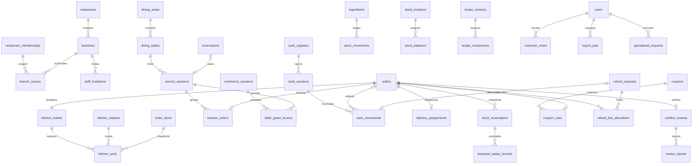

# Operational persistence

Every operational resource carries `restaurant_id` and `branch_id`. Composite foreign keys prevent cross-tenant/branch associations, including order and seated-reservation links. One OPEN visit/table and drawer/register are enforced by partial unique indexes. Unique order/ticket, line/station, order/coupon, order/review, component/reservation and operation-key identities prevent replayed effects. Immutable ledgers reject SQL updates/deletes; closed drawer figures reject mutation. Operational history includes kitchen, visit, cash, staff, review, coupon, stock and export changes; existing order/payment/outbox history stays authoritative for the original transactions. No operational table duplicates sale totals into a second order system.
